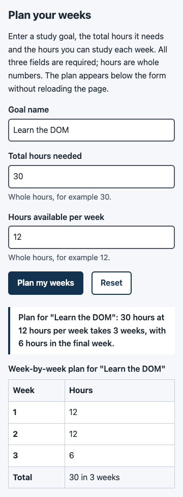
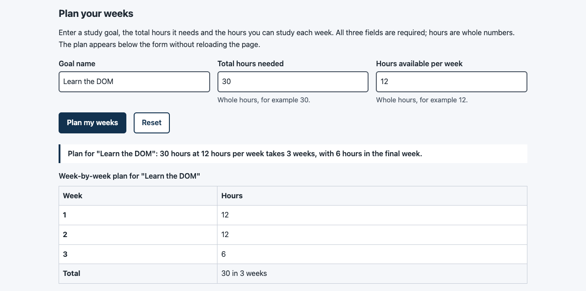
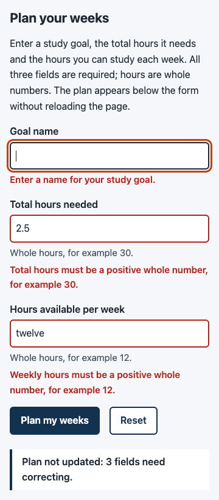
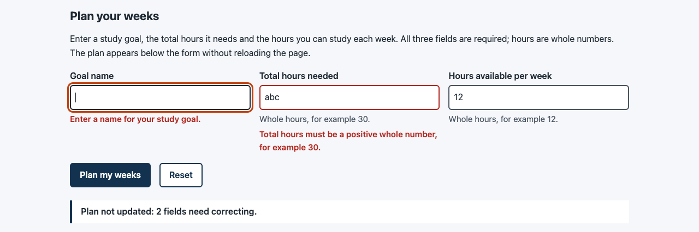

# Project 5 report - Interactive weekly planner

All outputs below were captured on 2026-10-11 on macOS with Node v24.14.0 and Google Chrome 155.0.8059.39 (headless, driven over the Chrome DevTools Protocol by the scripts in `scripts/`). GitHub Actions output is copied from the run log. Nothing was typed by hand; long outputs are trimmed to the relevant lines and trimming is marked with `...`.

## 1. Live URL, shared module and browser script

| Item | Value |
| --- | --- |
| Live URL | https://itsbhavinrey.github.io/studytrack-platform/#planner |
| Repository | https://github.com/itsbhavinrey/studytrack-platform |
| Shared calculation module | [`web/js/calculation.mjs`](../../../web/js/calculation.mjs), served at `/studytrack-platform/js/calculation.mjs` |
| Node bridge to it | [`src/calculation.js`](../../../src/calculation.js) (`module.exports = require('../web/js/calculation.mjs')`) |
| Browser script | [`web/js/planner.mjs`](../../../web/js/planner.mjs), served at `/studytrack-platform/js/planner.mjs` |
| Deployed commit | `bb57d5698a64468f3de982b26b737c52be18c485` (`feat(scripts): record a performance trace ...`, the last commit that changes `web/`) |
| Deployment | Actions run [38147886189](https://github.com/itsbhavinrey/studytrack-platform/actions/runs/38147886189), `workflow_dispatch` with `ref=bb57d56...` from branch `p05/interactive-planner` (the P4 "publish a specific commit" path). Jobs: build success, deploy success, verify success |

The P4 workflow was not changed. It publishes `web/`, and the shared module is inside `web/`, so it ships with no build step. When `main` is pushed, the push trigger redeploys the same `web/` content.

**One module, two runtimes.** `test/shared-module.test.js` proves both runtimes get the same functions, and that the file uses nothing that exists in only one of them:

```text
$ npm test
...
✔ the CommonJS bridge and the ES module expose the same functions (2.355042ms)
✔ the shared module has no Node-only or browser-only dependencies (0.5265ms)
```

The first test compares `require('../src/calculation')` with `await import('web/js/calculation.mjs')` and checks each export is the *same function object* (`===`), so the Node CLI and the browser run the same code. The second scans the code (comments stripped) for `require(`, `module.exports`, `import`, `process`, `__dirname`, `Buffer`, `window`/`document`/storage, and `console.`.

## 2. Deployment and rendering evidence (current)

Verify job log of run 38147886189 (the workflow checks the public site itself):

```text
Site: https://itsbhavinrey.github.io/studytrack-platform/  expected commit: bb57d5698a64468f3de982b26b737c52be18c485
GET https://itsbhavinrey.github.io/studytrack-platform/ -> 200 text/html; charset=utf-8
GET https://itsbhavinrey.github.io/studytrack-platform/styles.css -> 200 text/css; charset=utf-8
GET https://itsbhavinrey.github.io/studytrack-platform/no/such/page -> 404 text/html; charset=utf-8
resource js/planner.mjs -> 200
resource styles.css -> 200
```

From this machine afterwards (`S=https://itsbhavinrey.github.io/studytrack-platform/`):

```text
$ curl -s ${S}version.txt
commit: bb57d5698a64468f3de982b26b737c52be18c485
ref: bb57d5698a64468f3de982b26b737c52be18c485
run: 38147886189
$ for p in "" styles.css js/planner.mjs js/calculation.mjs; do curl -sS -o /dev/null -w "GET /studytrack-platform/$p -> %{http_code} %{content_type} %{http_version}\n" "$S$p"; done
GET /studytrack-platform/ -> 200 text/html; charset=utf-8 2
GET /studytrack-platform/styles.css -> 200 text/css; charset=utf-8 2
GET /studytrack-platform/js/planner.mjs -> 200 text/javascript; charset=utf-8 2
GET /studytrack-platform/js/calculation.mjs -> 200 text/javascript; charset=utf-8 2
```

`text/javascript` matters: browsers refuse a module script whose `Content-Type` is not a JavaScript MIME type. GitHub Pages serves the `.mjs` extension correctly.

`node scripts/check-site.mjs https://itsbhavinrey.github.io/studytrack-platform/ --screenshots docs/projects/p05/screenshots --prefix live-page` (checked 2026-10-11T14:37:31Z, `"ok": true`), network events at both P3 widths:

```text
360  horizontalScroll false  scrollWidth 360
  200 text/html; charset=utf-8        h2 [2606:50c0:8002::153]:443 secure  .../studytrack-platform/
  200 text/css; charset=utf-8         h2 [2606:50c0:8002::153]:443 secure  .../studytrack-platform/styles.css
  200 text/javascript; charset=utf-8  h2 [2606:50c0:8002::153]:443 secure  .../studytrack-platform/js/planner.mjs
  200 text/javascript; charset=utf-8  h2 [2606:50c0:8002::153]:443 secure  .../studytrack-platform/js/calculation.mjs
  404 text/html; charset=utf-8        h2 [2606:50c0:8002::153]:443 secure  https://itsbhavinrey.github.io/favicon.ico   (browser's own request, not required)
1280 horizontalScroll false  scrollWidth 1280
  (same four required requests, all 200)
```

The request for `calculation.mjs` comes from the `import` statement inside `planner.mjs`; the browser resolved `./calculation.mjs` against the module's own URL (`.../js/planner.mjs`).

Screenshots of the public site:

| | 360 px | 1280 px |
| --- | --- | --- |
| Whole page | [live-page-360.png](screenshots/live-page-360.png) | [live-page-1280.png](screenshots/live-page-1280.png) |
| Valid plan (30 / 12) |  |  |
| Invalid input |  |  |

## 3. All P1 input cases in the browser (Definition of done 1)

`node scripts/check-planner.mjs https://itsbhavinrey.github.io/studytrack-platform/ --screenshots docs/projects/p05/screenshots` checked the **public** site (2026-10-11T14:37:36Z): `23/23 browser checks passed`. Each case is typed into the real form with `Input.insertText` and submitted with a real mouse click (`Input.dispatchMouseEvent`).

| P1 case | Result in the browser | Focus after submit | Submit log lines |
| --- | --- | --- | --- |
| `30 12` | Plan for "Learn the DOM": 30 hours at 12 hours per week takes 3 weeks, with 6 hours in the final week. Rows `1 12`, `2 12`, `3 6` | stays on button | 1 |
| `24 12` | ... takes 2 weeks, with 12 hours in the final week. Rows `1 12`, `2 12` | stays on button | 1 |
| `5 12` | ... takes 1 week, with 5 hours in the final week. Row `1 5` | stays on button | 1 |
| `1 1` | Plan for "Learn the DOM": 1 hour at 1 hour per week takes 1 week, with 1 hour in the final week. Row `1 1` | stays on button | 1 |
| `0 12` | Total hours: "Total hours must be a positive whole number, for example 30." | `total-hours` | 1 |
| `30 0` | Weekly hours: "Weekly hours must be a positive whole number, for example 12." | `weekly-hours` | 1 |
| `-5 12` | Total hours: "Total hours must be a positive whole number, for example 30." | `total-hours` | 1 |
| `30 2.5` | Weekly hours: "Weekly hours must be a positive whole number, for example 12." | `weekly-hours` | 1 |
| `30 twelve` | Weekly hours: same message | `weekly-hours` | 1 |
| `30 12hours` | Weekly hours: same message | `weekly-hours` | 1 |
| `30` (missing) | Weekly hours: "Enter the hours available per week." | `weekly-hours` | 1 |
| `30 12 4` (extra) | Weekly hours: "Weekly hours must be a positive whole number, for example 12." | `weekly-hours` | 1 |

For every invalid case the check also asserts: only that field has `aria-invalid="true"` and an error; its `aria-describedby` starts with its error's id; the result is hidden; the status says `Plan not updated: 1 field needs correcting.`; and `window.__plannerCheck` (set after load) still exists, so the page did not reload. Across the whole run Chrome reported 2 main-frame navigations, which are the 2 deliberate loads (`{"navigations": 2}`).

The same 12 cases are unit-tested in Node against `validatePlanInput()` (`test/plan-input.test.js`), and the P1 CLI acceptance suite still passes (`Result: 13/13 tests passed.`).

Extra cases:

- **User input is text (C3).** Goal name `<b>bold</b>` gives the status `Plan for "<b>bold</b>": 30 hours ...`, with `{"xss": false, "img": 0}`: the markup is shown as characters, no `` or `<b>` element was created and the `onerror` code never ran.
- **Long plans.** `10000 / 1` gives `... takes 10000 weeks, with 1 hour in the final week.` and one sentence instead of 10,000 table rows.
- **Layout.** No horizontal scroll at 360 px or 1280 px with the result or the errors shown.

## 4. Repeated submit/reset cycles (Definition of done 2, R4)

Each cycle: submit a valid plan, then submit an invalid weekly value (`x`), then click Reset. After every reset the check requires all three values `""`, no `aria-invalid`, no error text, `aria-describedby` back to just the hint, status `""`, result hidden with 0 child elements, focus on `goal-name`, and exactly one submit log per submit and one reset log per reset.

```text
{"name": "five submit/reset cycles stay correct", "ok": true, "detail": [
  {"cycle": 1, "plan": "30/12", "validStatus": "Plan for \"Cycle 1\": 30 hours at 12 hours per week takes 3 weeks, with 6 hours in the final week.", "ok": true},
  {"cycle": 2, "plan": "24/12", "validStatus": "Plan for \"Cycle 2\": 24 hours at 12 hours per week takes 2 weeks, with 12 hours in the final week.", "ok": true},
  {"cycle": 3, "plan": "5/12", "validStatus": "Plan for \"Cycle 3\": 5 hours at 12 hours per week takes 1 week, with 5 hours in the final week.", "ok": true},
  {"cycle": 4, "plan": "1/1", "validStatus": "Plan for \"Cycle 4\": 1 hour at 1 hour per week takes 1 week, with 1 hour in the final week.", "ok": true},
  {"cycle": 5, "plan": "100/7", "validStatus": "Plan for \"Cycle 5\": 100 hours at 7 hours per week takes 15 weeks, with 2 hours in the final week.", "ok": true}]}
```

## 5. Keyboard and error announcements (Definition of done 3, R3)

Keyboard-only pass from a fresh load (Tab, typing, Enter and Space are real key events). Tab labels are the focused element's text with whitespace collapsed (`replace(/\s+/g, ' ')`), so the inline "weekly planner" link, which wraps across source lines, reads as one phrase:

```text
{"name": "keyboard: Tab reaches the form, Enter submits, focus goes to the invalid field, Space on Reset clears", "ok": true,
 "detail": {"tabsToGoalName": 11,
  "tabOrder": ["Skip to main content", "Goal", "Weekly availability", "Resources", "Sample weekly plan", "Weekly planner",
               "weekly planner", "MDN reference: HTML elements", "MDN guide: basic concepts of flexbox",
               "W3C: Understanding WCAG contrast (minimum)", "goal-name"],
  "afterEnter": "Plan for \"Keyboard goal\": 30 hours at 12 hours per week takes 3 weeks, with 6 hours in the final week.",
  "invalidFocus": "total-hours",
  "route": ["weekly-hours", "Plan my weeks", "Reset"],
  "afterReset": "goal-name"}}
```

Enter inside a text field submits the form (the browser's implicit submission); the emptied total-hours field received focus with the message "Enter the total hours needed."; Space on Reset cleared everything and put focus back on the first field.

What a screen reader is given, read from Chrome's computed accessibility tree (`Accessibility.getPartialAXTree`) after submitting an empty goal name and `abc` total hours:

```text
goal-name:   {"role": "textbox", "name": "Goal name", "description": "Enter a name for your study goal.",
              "invalid": "true", "focused": true, "required": true, "describedby": "goal-name-error"}
total-hours: {"role": "textbox", "name": "Total hours needed",
              "description": "Total hours must be a positive whole number, for example 30. Whole hours, for example 30.",
              "invalid": "true", "required": true, "describedby": "total-hours-error total-hours-hint"}
plan-status: {"role": "status", "live": "polite", "atomic": true, "relevant": "additions text"}
```

So focusing the first invalid field exposes its label, "invalid entry" and the error as its description, and the result sentence is written into a polite, atomic live region that exists from page load.

**Limit, stated plainly:** these checks read the accessibility tree that screen readers consume; no screen reader (VoiceOver, NVDA) was run, because one cannot be driven headlessly here. Listening once with VoiceOver (Cmd+F5 on macOS) is a useful manual follow-up.

## 6. Recording of valid, invalid and reset behaviour

[`perf/planner-recording.webm`](perf/planner-recording.webm) (408 KB, 900 x 900, 12.43 s), recorded from the **public** site with `node scripts/record-planner.mjs https://itsbhavinrey.github.io/studytrack-platform/ --out docs/projects/p05/perf`. Size and duration were read back by loading the file into a `<video>` element in Chrome: `{"width":900,"height":900,"durationSeconds":12.43}`.

Frames, each with a caption bar:

1. Empty form
2. 1. Valid input: goal name typed / total hours 30 / 12 hours per week
3. 1. Submit: plan shown, page not reloaded
4. 2. Invalid input: -5 and "twelve" (P1 cases)
5. 2. Submit: inline errors, focus on first invalid field
6. 3. Reset: values, errors and result cleared

How it was made: the script took a JPEG screenshot after each step, then drew the frames onto a `<canvas>` in Chrome and recorded `canvas.captureStream()` with `MediaRecorder` (there is no ffmpeg on this machine). It is a step-by-step recording, not a continuous screen capture, so typing appears field by field. GitHub shows `.webm` files as a download; open it in a browser to play it.

## 7. Performance capture: layout versus paint (R6)

File: [`perf/planner-trace.json.gz`](perf/planner-trace.json.gz), a Chrome trace of the public site (DevTools > Performance > "Load profile..." opens it). Summary written by the same script: [`perf/trace-summary.json`](perf/trace-summary.json).

Two interactions were recorded, each between `performance.mark()` calls (they appear in the Timings track):

| Interaction | Recalculate style | **Layout** | Paint |
| --- | --- | --- | --- |
| `submit`: click "Plan my weeks" with 30 / 12 | 4 | **1** (`dirtyObjects: 39` of `totalObjects: 246`, 0.308 ms) | 3 |
| `focus`: press Tab from "Plan my weeks" to "Reset" | 3 (1 element each) | **0** | 2 |

### A DOM change that triggers layout

Chrome's invalidation tracking names the change and the code that made it:

```text
style invalidations during onSubmit (planner.mjs:141):
  #text                                    "Node was inserted into tree"   <- status.textContent = describePlan(...)   (line 166)
  DIV id='plan-status' class='plan-status' "Related style rule"            <- .plan-status:empty no longer matches
  DIV id='plan-result' class='plan-result' "Attribute"                     <- result.hidden = false                    (line 168)
layout invalidations (recorded during the next Recalculate style):
  DIV id='plan-status'  "Style changed"
  DIV id='plan-result'  "Added to layout"
  TABLE, CAPTION, THEAD, TBODY, TFOOT, 5 x TR, 6 x TH, 4 x TD, 12 x #text   "Added to layout"
then: Layout  dirtyObjects 39 / totalObjects 246  -> Paint
```

`result.replaceChildren(buildPlanTable(...))` and `result.hidden = false` (lines 167-168) add new boxes to the page, and the status text makes `.plan-status:empty` stop matching, so its padding and border return. New boxes and changed padding change geometry, so the browser must compute sizes and positions again (**layout / reflow**) before it can paint. The trace also shows the order: the script only marks things dirty; the work happens in the next rendering step.

### A visual change that only needs painting

```text
focus: style invalidations  BUTTON class='button-secondary'  "PseudoClass"  during browser default action for "keydown"
       Recalculate style x3 (1 element each), Layout 0, Paint 2
```

Tab moved focus to Reset, so `:focus-visible` started to match and `outline: 3px solid var(--color-focus)` (styles.css line 434) applied. An outline is drawn outside the box and never takes up space, so no box moves: style is recalculated for one element, layout is skipped and the browser only **repaints**. The same reasoning applies to the red border of an invalid input (`.field input[aria-invalid="true"] { border-color: ... }`, line 246): only the colour of an existing 2 px border changes.

(The `step` FunctionCalls with an empty URL in the trace are the recording script's own `requestAnimationFrame` waits; they do not touch the DOM.)

## 8. Duplicate-handler drill (break it on purpose)

| | |
| --- | --- |
| **Fault** | On temporary branch `drill/p05-double-submit-handler` (commit `34464ee`), planner.mjs got a plausible "make sure the form is ready" block: `document.addEventListener('DOMContentLoaded', () => { wirePlanner(document.getElementById('planner-form')); });`. Module scripts already run after parsing, so `wirePlanner()` ran once at the top level and again when `DOMContentLoaded` fired. |
| **Symptom** | The page *looked* correct, because both handlers wrote the same result. The duplicate work was visible only in the log and in the listener list. |
| **Evidence** | Below. |
| **Repair** | `git revert` of the drill commit on the branch (`222d812`), leaving one `wirePlanner()` call. |
| **Verification** | One log line per submit, one listener per action, browser checks 21/21, `npm test` 77/77 + 13/13. The branch's diff against `main` was then empty (`0 lines`) and the branch was deleted (`git branch -D`); it was never pushed. |

With the fault (one click on "Plan my weeks", page served locally by `scripts/serve.mjs`):

```text
console after ONE click on "Plan my weeks":
  [planner] submit handled by handler #1 (run 1)
  [planner] submit handled by handler #2 (run 1)
DOMDebugger.getEventListeners(#planner-form):
  submit  script 3 line 141
  submit  script 3 line 141
  reset  script 3 line 174
  reset  script 3 line 174
```

Two listeners whose source is the same line (141, `function onSubmit`) means the *same code* was registered twice as two different function objects, which points at whatever creates them. `grep -n "wirePlanner(" web/js/planner.mjs` found the second call:

```text
186:wirePlanner(document.getElementById('planner-form'));
191:document.addEventListener('DOMContentLoaded', () => {
192:  wirePlanner(document.getElementById('planner-form'));
```

The automated checks caught it as well:

```text
$ node scripts/check-planner.mjs          (exit 1)
FAIL  form has exactly one submit and one reset listener      detail: ["reset", "reset", "submit", "submit"]
FAIL  valid 30 / 12: 3 weeks, final week 6 hours               submitLogs: ["... handler #1 (run 1)", "... handler #2 (run 1)"]
... (14 checks failed in total)
7/21 browser checks passed

$ npm test                                (exit 1)
✖ planner.mjs registers one listener per action, once
  AssertionError [ERR_ASSERTION]: Expected values to be strictly deep-equal:
  + actual - expected
    [
  +   'DOMContentLoaded',
      'reset',
      'submit'
    ]
```

After the repair:

```text
console after ONE click on "Plan my weeks":
  [planner] submit handled by handler #1 (run 1)
DOMDebugger.getEventListeners(#planner-form):
  submit  script 3 line 141
  reset  script 3 line 174
check-planner exit 0   21/21 browser checks passed
```

A side experiment in the same page shows why a closure factory is the dangerous case: registering the **same** function reference twice is ignored by the browser.

```text
same function reference registered twice -> runs per submit: 1
```

`addEventListener` drops a second identical (type, listener, capture) registration, but `wirePlanner()` creates new `onSubmit`/`onReset` closures on every call, and two new function objects are never identical.

## 9. Constraints (C1-C3) and one handler per action (R5)

From `npm test` (`test/web.test.js`):

```text
✔ index.html loads the planner as one module script
✔ index.html: no inline event-handler attributes
✔ 404.html: no inline event-handler attributes
✔ js/calculation.mjs: every relative import resolves to a file in web/js/
✔ js/calculation.mjs: no HTML insertion and no browser storage
✔ js/planner.mjs: every relative import resolves to a file in web/js/
✔ js/planner.mjs: no HTML insertion and no browser storage
✔ planner.mjs registers one listener per action, once
```

In the browser, `form has exactly one submit and one reset listener` (`["reset", "submit"]`) and `no inline on* event attributes in the page` both passed on the public site. No packages were added (`package.json` has no dependencies); no framework, form library or storage API is used.

The closure used by the handlers is explained in [learning.md](learning.md#33-closures-and-event-handler-state).

## 10. Why Node's `process.argv` cannot be used directly in this browser module

`process` is a global object that **Node** creates when it starts a program; `process.argv` is that program's command line (`['/path/to/node', '/path/to/planner.js', '30', '12']`), copied from the arguments the operating system gave the process. A browser does not start a page from a command line and defines no `process` global, so in `planner.mjs` the name `process` is simply undeclared: the first `process.argv` would throw `ReferenceError: process is not defined` and stop the module. More fundamentally, a web page has no command line to read. Its input arrives as **events** (`submit`, `reset`) carrying the values of form controls, at any time and any number of times, instead of once at start-up.

That is why the code is split the way it is:

- `web/js/calculation.mjs` takes plain values as parameters and returns plain values, and touches neither `process` nor `document`. Both runtimes can run it.
- Each runtime has its own thin adapter that collects input and shows output: `src/cli.js` reads `process.argv.slice(2)` (passed in by `planner.js`), prints with `console.log` and exits with `process.exit`; `web/js/planner.mjs` reads `input.value` inside a submit handler and writes with `textContent`.

Even the *shape* of the input differs. argv is an array of words already split by the shell, so P1 never saw spaces around `12`. A form field is one string that can contain anything, which is why `validatePlanInput()` trims first and why `12 4` (P1's "too many arguments") becomes an invalid value inside one field.

## 11. Test summary

```text
$ npm test
ℹ tests 77
ℹ suites 17
ℹ pass 77
ℹ fail 0
...
Result: 13/13 tests passed.

$ npm run test:browser          (serves web/ locally on a free port)
21/21 browser checks passed

$ node scripts/check-planner.mjs https://itsbhavinrey.github.io/studytrack-platform/ --screenshots docs/projects/p05/screenshots
23/23 browser checks passed     (2 extra checks with --screenshots: no horizontal scroll at 360 and 1280 px)
```

`npm test` grew from 47 (end of P4) to 77 node tests: `test/shared-module.test.js` (2), `test/plan-input.test.js` (20) and 8 new checks in `test/web.test.js`.
